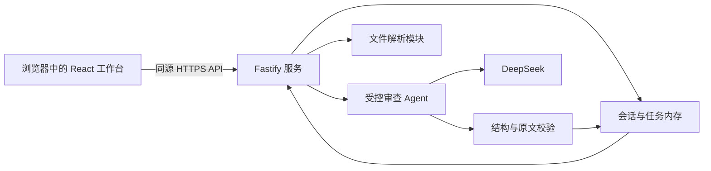

# 法学论文审查助手技术方案

版本 v0.1 · Web MVP · 2026-11-10

依据《产品设计文档》v0.2（[文档](产品设计文档.md)）、[HTML Demo](../archive/法学论文审查助手-Demo.html)，以及已确定的 Web 与受控审查工作流方向编写。本文保存初始技术设计，当前交付能力及目录以 [项目说明](../README.md) 为准。

## 一、方案概览

采用 React Web 前端、Node.js 后端和 DeepSeek 模型服务。用户通过浏览器完成论文输入、审查依据确认、原文修改及多轮复查，后端负责文件解析、密钥会话、模型调用与结果校验。

首版围绕 1500—5000 字片段的完整审查流程落地。前端和后端统一使用 TypeScript，共享输入约束与数据结构。现有 HTML Demo 作为交互和视觉参考，开发时将页面拆分为可维护的 React 组件，并逐项接入真实能力。

### 技术选型

| 层次 | 选择 | 用途 |
|---|---|---|
| 前端 | React + TypeScript + Vite | 页面组件、交互流程与前端构建 |
| 样式 | Tailwind CSS | 延续 Demo 的分栏、卡片、蓝色主操作和窄屏布局 |
| 后端 | Node.js 当前受支持的 LTS + TypeScript + Fastify | HTTP 接口、会话管理、文件解析和审查任务调度 |
| 结构校验 | Zod | 共享请求与结果结构，校验模型输出和接口输入 |
| 文件解析 | PDF.js（pdfjs-dist）+ Mammoth | 文字型 PDF 与 .docx 正文提取 |
| 模型 | DeepSeek | 默认 deepseek-chat，可选择 deepseek-reasoner |
| 数据存放 | 前后端会话内存 | 当前论文、任务与轮次快照，按会话清理 |
| 自动化验证 | Vitest + React Testing Library + Fastify inject + Playwright | 业务单元测试、组件测试、接口测试与浏览器流程验证 |

依赖在初始化工程时选择相互兼容的稳定版本，提交锁文件。后续跨会话历史落地时，再引入数据库与迁移方案。

## 二、整体结构



前端负责编辑和展示，后端统一执行权威校验并保存当前工作区状态。模型请求只包含该次任务需要的片段、背景、确认依据和上一轮问题。

### 工程目录

```text
apps/
  web/                   React 页面、工作区状态、API 客户端
  server/                Fastify 接口与服务入口
    src/
      files/             文件识别与文本提取
      reviews/           会话、工作区、轮次与演示样本
      agent/             工作流、提示词与模型适配
packages/
  shared/                Zod Schema、枚举和文本处理约束
config/                  Vite、Vitest、Playwright 配置
docs/                    产品设计与技术方案
archive/                 早期独立 HTML 原型
tests/
  unit/                  业务、接口与组件测试
  e2e/                   浏览器流程测试
  docs/                  文档与目录引用检查
  support/               测试服务入口与响应替身
scripts/                 构建脚本
artifacts/               本地测试输出，由工具生成
dist/                    前后端构建输出，由工具生成
```

Python 文档检查集中在 tests/docs，TypeScript 与浏览器测试分别位于 tests/unit、tests/e2e。使用根目录的 pnpm 命令运行，命令已指定 config 中的对应配置文件。

## 三、前端工作台

按输入页、对话流程页、审查工作台和通用弹窗组织组件，沿用产品文档中的四步进度。

- 输入页管理正文、文件状态、可选背景、示例片段和模型选择。
- 对话流程页展示真实任务阶段、研究问题与核心观点确认卡片。用户确认后才提交审查任务。
- 审查工作台提供原文与卡片双向定位、逐段编辑、建议采纳、材料清单、反馈和轮次切换。
- 设置弹窗管理连接测试、密钥替换、清除和会话剩余时间，报告弹窗展示所选轮次的数据。
- 工作区状态采用 React Context + useReducer 集中管理，异步操作状态与历史快照分别保存。

段落编辑先保留本地草稿，保存成功后更新工作区修订号。提交审查或复查前等待修改保存完成。失败时保留草稿并提示重试。

进度由服务端任务阶段驱动。模型处理中展示阶段名称与等待状态，阶段完成后更新进度，前端以约 1.5 秒间隔查询任务状态，并在任务结束或页面离开后停止查询。

## 四、审查 Agent 与执行流程

### 运行方式

首版采用单个受控审查 Agent，由 TypeScript 工作流协调模型分析、程序工具和人工确认。工作流中的步骤、输入、输出和停止条件由程序定义，使用显式状态管理实现。

模型负责提取研究问题、分析论证和表达、提出修改方向及判断复查结果。程序工具负责分段计数、文件解析、原文匹配、结构校验、版本记录和报告生成。

### 首轮流程

1. **准备输入**。校验字数和背景长度，生成稳定段落 ID 与工作区修订号。
2. **提取依据**。向模型发送正文及已有背景，返回研究问题、核心观点、主要论据及待补充标记。
3. **人工确认**。保存用户编辑后的确认依据。研究问题和至少一项核心观点非空时允许继续。
4. **执行审查**。将确认依据、正文、提纲及引用材料一同发送模型，检查四类论证问题和表达问题，形成候选问题及待补材料。
5. **回读核对**。将候选问题与相关段落提交模型复核，检查问题依据、引用语境、跨段关系和结论范围。
6. **程序校验与提交**。校验结构、引用、关联 ID 和重复问题，生成第 1 轮快照并进入工作台。

人工确认阶段结束当前提取任务，将结果保存在会话中。确认操作创建新的审查任务，工作流无需保持一个等待用户输入的长连接。

### 复查流程

复查输入包含上一轮快照、当前正文、更新后的确认依据及材料完成状态。模型逐条判断旧问题，返回“已解决”“仍需补充”“需重新判断”及理由。原句改变、材料勾选完成均作为判断线索，最终结果需要结合修改后的内容。

研究问题或核心观点变化时，重新检查受影响的问题。新发现的问题分配新 ID，旧问题保留原 ID，结果与依据写入新一轮快照。完整校验成功后，再发布该轮结果。

### 模型接口与输出

模型服务地址固定为 https://api.deepseek.com，通过后端适配模块调用。模型白名单为 deepseek-chat、deepseek-reasoner，连接测试使用当前所选模型的简短请求。

提示词与输出 Schema 分开维护，并记录版本。调用时要求结构化 JSON，后端通过 Zod 校验。具体请求参数及结构化输出能力在接入时分别验证两个模型。

正文、提纲和参考材料作为有边界的待分析数据传入，模型审查指令由应用维护。返回结果中的段落 ID、问题状态和材料关联均需经过程序校验。

首版法条、案例和文献核验沿用“外部材料待核验”状态。接入授权资料源后，工具层再增加检索及来源核验能力。

## 五、数据、定位与轮次一致性

### 主要数据对象

| 对象 | 主要信息 |
|---|---|
| Session | 随机会话 ID、工作区、凭据引用、最后活动时间、任务集合 |
| Credentials | API Key、选定模型、已验证模型、测试时间、到期时间、配置代次 |
| Workspace | workspaceId、revision、论文题目、段落、背景、当前确认依据、材料与反馈 |
| Paragraph | 稳定 id、展示顺序、文本 |
| ConfirmedBasis | 研究问题、核心观点、主要论据及关联段落、待补充标记 |
| Issue / Expression | 稳定 id、类型、优先级或法律含义提示、原文锚点、说明和建议 |
| Material | 稳定 id、任务描述、关联问题 ID、完成状态、外部核验标记 |
| RoundSnapshot | roundId、轮次、正文、确认依据、问题、材料、反馈、复查结果、实际模型、提示词与 Schema 版本、时间 |
| Job | jobId、workspaceId、输入修订号、基准轮次、幂等键、任务类型、阶段、状态、错误码 |

论证问题类型采用“概念混用”“论据与结论脱节”“前后矛盾”“分析层次混淆”。判断状态采用“文本内可确认”“论证待补充”“学术争议”“外部材料待核验”。优先级采用“高”“中”“低”，反馈采用“有帮助”“判断不成立”“暂不处理”。

### 原文定位

锚点包含 paragraphId、quote、start、end，偏移按 JavaScript UTF-16 计数并采用左闭右开区间。偏移由程序根据原文计算，模型负责返回段落 ID 和原句。

同一段出现多处相同引文时，结合上下文定位。仍有歧义的引文展示待核对状态并关闭一键替换。无法匹配的候选问题进入结果修正或材料不足提示，返回给前端的可操作卡片必须具有已验证锚点。

保存段落或采纳建议后，增加工作区 revision，并重新校验相关锚点。替换时同时检查 paragraphId、revision 和对应文本，发生冲突时提示重新定位。逐段编辑保留稳定段落 ID，重新导入正文后重新提取与确认依据。

### 轮次与报告

任务启动时冻结输入快照。任务完成时检查工作区和基准轮次是否仍匹配，过期结果显示需要重新提交，避免覆盖较新的修改。

RoundSnapshot 保存该轮全部审查数据，并作为只读历史。当前工作区中的材料勾选、反馈和依据修改保存在工作副本中，下一轮创建时一起冻结。

历史轮次报告从对应快照生成。最新轮次报告以已审查快照为主体，作者刚更新的反馈与材料进度作为独立附录，并注明尚待复查的正文修改及材料状态。报告记录该轮实际使用的模型，切换设置中的模型后，已有报告仍读取快照中的模型字段。

## 六、文件解析

服务端校验扩展名、文件特征和上传大小，单文件上限采用 20 MB，按 20 × 1024 × 1024 字节执行。支持类型及处理方式如下。

| 格式 | 处理方式 |
|---|---|
| .txt / .md | 按 UTF-8 解码，编码异常时提示用户转换后重传 |
| .docx | 使用 Mammoth 提取正文，保留用于分段的换行 |
| 文字型 .pdf | 使用 PDF.js 提取文字，按页内布局整理顺序，解析后由用户预览确认 |
| .doc | 部署具备超时与资源限制的隔离 LibreOffice 转换进程，转换成 .docx 后继续解析 |
| 扫描版 PDF | 检测到缺少可用文字时说明需要 OCR，后续扩展 OCR 服务 |

旧版 .doc 作为独立交付项，在提供转换运行环境后验收。文件解析成功后统一展示文本预览，用户选择或编辑到 1500—5000 字再开始审查。

正文计数按去除空白字符后的 UTF-16 长度执行，包含标点，与 Demo 的 JavaScript 规则保持一致。按换行拆分并忽略空段。前后端复用同一实现，同时约束提纲与引用材料长度，控制模型总输入。

解析采用独立任务或工作线程，设置文件页数、解压后大小、执行时间和资源上限。仅保留解析所需临时文件，在成功、失败和取消路径中清理，并在服务启动时清理遗留文件。

## 七、接口与任务恢复

### 接口划分

| 方法与路径 | 职责 |
|---|---|
| POST /api/sessions | 创建浏览器会话 |
| DELETE /api/sessions/current | 结束会话并清理关联数据 |
| POST /api/credentials/test | 测试候选密钥与模型，成功后更新配置 |
| GET /api/credentials/status | 返回脱敏信息、已验证模型及剩余时间 |
| POST /api/credentials/reveal | 为临时查看返回当前会话的密钥，响应仅保留于短暂展示状态 |
| DELETE /api/credentials | 清除当前密钥并更新配置代次 |
| POST /api/files/parse | 上传文件并创建解析任务 |
| GET /api/workspace | 读取当前工作区与已完成轮次列表 |
| PUT /api/workspace | 按 revision 保存正文、背景、确认依据、材料和反馈 |
| DELETE /api/workspace | 删除当前审查数据，保留模型配置 |
| POST /api/extractions | 基于当前工作区创建提取任务 |
| POST /api/reviews | 基于已确认依据创建首轮审查任务 |
| POST /api/rechecks | 基于上一轮快照创建复查任务 |
| GET /api/jobs/:jobId | 查询任务状态及阶段，完成后返回结果引用 |
| DELETE /api/jobs/:jobId | 取消任务并撤销后续提交 |
| GET /api/rounds/:roundId | 读取所选轮次的完整快照 |
| GET /api/rounds/:roundId/report | 生成所选轮次的报告 |

所有资源访问均绑定当前会话。工作区更新使用 revision 乐观校验，后台按任务输入快照执行。模型响应和解析输出再次进行服务端校验。

### 重试、取消与并发

- 创建任务请求携带 Idempotency-Key，重复提交返回同一任务。每个工作区同时执行一个会改变审查结果的任务。
- 任务状态采用 queued、running、succeeded、failed、cancelled，失败响应带错误码和可重试标记。
- 网络异常、限流及服务端临时失败采用有上限的退避重试，并遵循服务端返回的 Retry-After。密钥无效和额度不足展示相应处理入口。
- JSON 或 Schema 校验失败时，最多执行一次结果修正请求，仍失败则保留输入并展示重试入口。
- 每次任务配置超时和调用次数上限，区分通用模型与推理模型预算，记录调用耗时及用量。预算通过实际片段联调后确定。
- 取消、新建审查或会话清理时，使用 AbortController 中止请求。提交结果前再次检查取消状态、workspaceId 和 revision。
- 密钥替换、清除或到期时，终止使用旧配置的任务。异步连接测试仅在配置代次仍一致时写回，阻止迟到结果恢复已清除的凭据。
- 轮次仅在全部必要步骤成功后发布。任务在会话内保存各阶段结果及输入快照，失败任务保留可重试输入，用户从明确的失败阶段恢复，已提交轮次保持可追溯。

页面断网后可以凭当前页面内的会话信息查询已有任务。服务进程重启后，内存任务返回会话失效提示，引导重新配置并提交。

## 八、密钥、会话与数据清理

浏览器通过同源 HTTPS API 连接后端。API Key 在用户输入时短暂存在于输入框状态，提交成功后清空，后续显示所需的脱敏信息由后端返回。临时查看通过已绑定会话的接口获取，并设置短暂展示和关闭清除。

密钥在后端会话内存中保存，成功测试后有效期为 2 小时，重新测试成功后重新计时。切换模型后验证所选模型的可用性，再允许执行对应模型任务。每次任务调度都检查到期时间，定时清理负责移除已到期凭据。

会话标识使用不可预测的随机值，由浏览器保存在页面内存中并通过请求头发送。前端及后端统一处理会话隔离，正文与凭据相关响应设置 Cache-Control 为 no-store。跨站访问按同源策略限制，日志采用字段白名单记录请求 ID、阶段、错误码、耗时和用量。

### 生命周期

| 操作或条件 | 数据处理 |
|---|---|
| 新建审查 | 删除当前工作区、轮次及任务，取消进行中调用，保留当前密钥配置 |
| 主动清除密钥 | 清除凭据、失效旧配置任务，当前论文与已完成结果继续可见 |
| 密钥到期 | 清除凭据并提示重新配置，已完成审查结果继续可见 |
| 刷新或关闭页面 | 页面内存释放，正常离开时尝试请求清理，新页面创建新会话 |
| 后端遗留会话 | 建议按最后一次有效操作后 2 小时清理，有效操作限定为配置测试、工作区修改或提交任务 |
| 服务进程重启 | 内存会话与审查记录释放，用户重新配置和提交 |

离开页面时的清理请求采用尽力发送机制，服务端到期清理负责处理遗留会话。页面向用户说明浏览器会话重置与服务端最长保留窗口，发布前核对模型及检测供应商的数据处理条件。

后端遗留会话的 2 小时清理窗口为本方案提出的初始技术假设，需结合试用反馈和数据处理要求确认。API Key 的 2 小时有效期沿用产品文档。

## 九、检测服务与部署

### 检测服务

查重率检测与 AI 率检测分别定义服务适配接口，输入当前确认的检测范围，输出来源、实际指标、片段及指标说明。供应商确认后补充凭据字段、调用方式、收费与数据处理条件，并优先接入一项完成真实验收。

服务状态区分待接入、处理中、成功及失败。演示结果带独立的示例标识和数据来源，真实任务依据实际服务响应展示结果。外部材料核验继续记录所需出处与人工核对状态。

### 部署与开发环境

首轮试用采用单实例部署，前端静态资源与 API 由同一域名访问，入口配置 HTTPS。开发时使用 Vite 代理到本地 Fastify，减少开发和部署环境的接口差异。

文件解析和旧版 .doc 转换配置独立执行边界及资源限制。部署设置连接测试限流、任务并发上限和请求大小限制，公开试用前用目标模型进行真实联调。

内存会话适合初期 10—12 人试用。扩展到多实例或跨会话恢复时，再引入共享会话存储、数据库及后台任务队列，保留现有的工作区、任务和轮次契约。

## 十、实施顺序与验证

| 阶段 | 交付内容 | 通过条件 |
|---|---|---|
| 1. 工程与界面 | 前后端工程、共享 Schema、Demo 组件化、基础状态管理 | 输入、确认、卡片、编辑、轮次与窄屏交互可演示，模拟数据明确标识 |
| 2. 模型与初审 | 真实连接测试、提取、人工确认、审查和回读校验 | 两个模型分别联调，确认依据进入请求，输出问题具有可核对原文 |
| 3. 修改与复查 | 工作区修订、材料和反馈、多轮快照及报告 | 三类复查结果有依据，历史只读，报告与所选轮次一致 |
| 4. 文件与异常 | TXT / .md / .docx / 文字型 PDF，独立完成 .doc 转换，超时取消和会话清理 | 实际文件解析通过，异常可恢复，密钥及会话隔离通过验证 |
| 5. 试用与检测 | 用户评估、调用用量记录、首个检测供应商接入 | 试用记录可追溯，检测指标与来源真实，产品目标按实际样本评估 |

### 自动化验证

- 单元测试覆盖计数分段、字数与文件大小边界、Schema、锚点定位、重复引文、轮次快照及报告生成。
- 组件测试覆盖确认必填项、建议采纳、材料进度、轮次切换与历史只读。
- 接口测试覆盖会话隔离、2 小时到期、密钥替换与清除、并发修订、幂等提交、任务取消和临时文件清理。
- 流程测试覆盖粘贴或上传、确认、初审、修改、复查、复制报告，以及失败重试和新建审查。
- 回归样本覆盖四类论证问题、四种判断状态、三类复查结果、表达修改及材料不足情况，保留法学评审分歧。

日常测试使用可控的模型和检测响应替身，真实服务联调单独执行并记录模型、提示词版本、样本数量、耗时和费用。80% 问题准确率沿用产品文档中的内部试验目标，通过法学背景评审统计实际结果。

每轮修改完成后更新相关测试，通过全部验证后创建对应 Git commit，交付提交编号、摘要和验证结果，并使用 `git log --graph --oneline --decorate --all` 查看版本历史。

### 待落地事项

- 根据真实试用材料确定提示词、模型调用预算、背景长度及解析资源上限。
- 确认后端遗留会话清理窗口，并将最终数据处理说明同步到产品文档与页面。
- 验证 .doc 转换在目标部署环境中的稳定性，积累 PDF 段落顺序校验样本。
- 确定检测供应商、首个接入类型、费用和数据处理条件。
